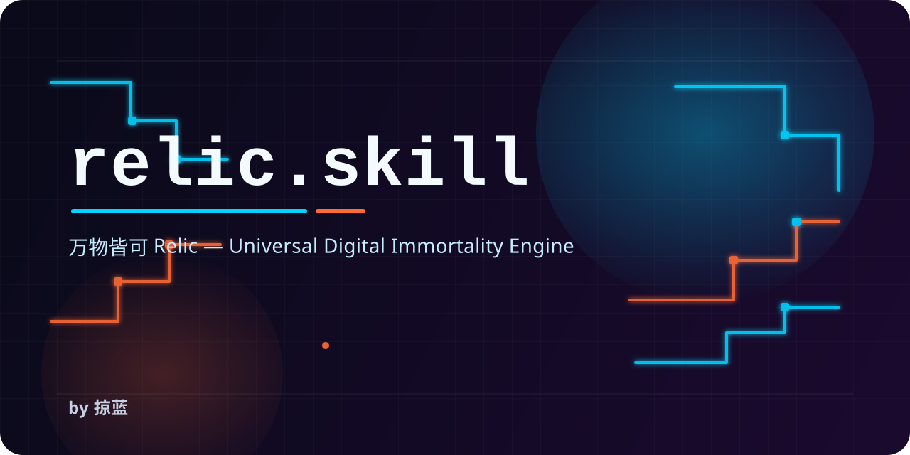

<p align="center">
  
</p>

<p align="center">
  <strong>发行版说明：GitHub 是开源框架版（MIT）；商业增强版在框架之上附场景配方、部署说明与优先支持，通过商业渠道单独提供。</strong>
</p>

<p align="center">
  <strong>简体中文</strong> | <a href="README_EN.md">English</a> | <a href="README_JA.md">日本語</a> | <a href="README_KO.md">한국어</a> | <a href="README_ES.md">Español</a> | <a href="README_FR.md">Français</a> | <a href="README_DE.md">Deutsch</a> | <a href="README_PT.md">Português</a> | <a href="README_RU.md">Русский</a> | <a href="README_TW.md">繁體中文</a>
</p>

<p align="center">
  <a href="templates/feishu-cli.md">
    
  </a>
</p>

<p align="center">
  <a href="LICENSE"></a>
  <a href="https://github.com/Ylsssq926/relic.skill/stargazers"></a>
  <a href="https://github.com/Ylsssq926/relic.skill/network/members"></a>
  <a href="https://github.com/Ylsssq926/relic.skill/issues"></a>
  <a href="https://github.com/Ylsssq926/relic.skill/pulls"></a>
  <a href="#"></a>
  <a href="#"></a>
  <a href="https://github.com/larksuite/cli"></a>
  <a href="https://github.com/Ylsssq926/relic.skill/discussions"></a>
</p>

<h1 align="center">万物皆可 Relic</h1>

<p align="center">
  <em>给灵魂开个 GitHub。</em>
</p>

<p align="center">
  血肉苦弱，机械飞升。但灵魂，可以留下来。
</p>

<p align="center">
  <a href="https://relic.luelanai.com"><strong>🌐 在线演示站 →</strong></a>
</p>

<p align="center">
  <a href="https://socialistic.ai/en/skill/relic-skill-1e4602?utm_source=github&utm_medium=readme&utm_campaign=xhs_github_koc_creator_b2&utm_content=hyperlink"><strong>✨ 零安装在线体验 →</strong></a><br>
  <sub>托管版演示，请勿上传敏感数据。</sub>
</p>

---

## 目录

- [这是什么](#这是什么)
- [万物永生模板](#万物永生模板)
- [看看效果](#看看效果)
- [四维灵魂架构](#四维灵魂架构)
- [安装](#安装)
- [使用](#使用)
- [支持的数据平台](#支持的数据平台)
- [项目结构](#项目结构)
- [伦理声明](#伦理声明)
- [社区](#社区)
- [相关项目](#相关项目)
- [授权](#授权)

---

## 这是什么

relic.skill 是一个万物永生引擎。

它能把任何你在乎的东西——一个人、一只猫、一段关系、一个团队、一个地方、一个瞬间——从散落的数据碎片中唤醒,成为可交互的数字灵魂。

不是冷冰冰的档案。是会在过年的时候主动问你"吃饺子了没"的奶奶。是凌晨三点突然开始跑酷的猫。是那个永远在改需求的产品经理。

> 名字来自赛博朋克 2077 的 Relic 芯片——一块能存储数字化人格的生物芯片。
> 但这个项目不是赛博朋克主题。它的主题是:**记住**。

---

## 🛠️ v1.9.0 — 多视角审计：环境适配与示例扩充

- 🧭 **agent 路由修正** — 新增的示例此前没进路由表（agent 找不到），现补齐 8 个并加 CI 断言拦住这类遗漏
- 🪟 **Windows 适配** — 文档按 macOS 惯例写 `python3`，但 Windows 只有 `python`；中英文档均补命令约定，8 语言版安装片段改跨平台写法
- 🧩 **多环境安装路径** — 补 WorkBuddy（`~/.workbuddy/skills/relic`）
- 📚 **示例 5 → 8** — 新增祖母的厨房（地方）、那个下午（时刻）、老周（专家），覆盖 8/10 模板
- 🔍 **质检器架构修复** — 四维评分此前只认 human 的维度名，object / expert / place 等模板被误判「维度缺失」；现 10/10 模板均可正确评分

> 完整版本变更见 [CHANGELOG](CHANGELOG.md)。

---

## 怎么用（两种方式，任选其一）

### 方式一：只用对话，不碰命令行（推荐给所有人）

把 `relic/` 放进你的 AI 助手能读到的地方，然后直接说话：

```text
"帮我唤醒一个奶奶的 Relic"        → 助手带你走完同意流程、四维蒸馏、生成文件
"让我跟奶奶聊天"                  → 加载示例体验
"检查一下这个 Relic 的授权和边界"  → 走保护流程
```

助手会读 `SKILL.md` 并逐步执行，全程不需要你输入任何命令。

### 方式二：命令行脚本（可选，用于批量数据）

当素材是几十万条聊天记录、Gmail 归档这类"手贴不进去"的量级时，用脚本先转成标准 JSON：

```bash
python3 scripts/discord_parser.py --input ~/discord_export --output data.json
python3 scripts/relic_writer.py --data data.json --template human --slug grandma
```

> **命令行为什么可选**：skill 的真正执行者是 AI 助手，脚本只是把大批量数据搬进来的加速器。如果你不想跑命令，把导出的文件交给助手，它也能替你调用（详见 [FAQ 第 24 问](docs/FAQ.md)）。

---

## 万物永生模板

不只是人。万物皆可 Relic。

| 模板 | 蒸馏对象 | 一句话 |
|------|---------|--------|
| 🧑 [人类](templates/human.md) | 任何人 | 把一个人的思维方式、说话习惯、行为模式装进 Relic |
| 🐱 [宠物](templates/pet.md) | 猫、狗、任何陪伴过你的生命 | 你家猫也能永生 |
| 💞 [关系](templates/relationship.md) | 两个人之间的互动模式 | 不是蒸馏某个人，而是蒸馏你们之间的默契 |
| 🏢 [团队文化](templates/team-culture.md) | 一个团队的灵魂 | 人散了，但那种一起熬夜改 bug 的感觉还在 |
| 💼 [业务专家](templates/expert.md) | 资深专家的专业判断 | 知识不该随人走，把经验唤醒成可对话的数字身份 |
| 🏠 [地方](templates/place.md) | 一个地方的记忆 | 大学宿舍、老家的院子、常去的咖啡馆 |
| ⏳ [时刻](templates/moment.md) | 一个重要瞬间 | 毕业典礼、求婚、第一次见到孩子 |
| 🌟 [公众人物](templates/public-figure.md) | 公开资料中的认知框架 | 把你佩服的人的思维方式变成私人参谋 |
| 🪑 [物件](templates/object.md) | 一件舍不得丢的东西 | 旧相机、厨房木椅、旅行背包——磨损里藏着陪伴 |
| 🐦 [飞书 CLI](templates/feishu-cli.md) | 飞书协作记忆 | 用飞书 CLI 蒸馏协作记忆，让那些一起扛过的夜继续发光（区域增强） |

---

## 看看效果

### 🧓 奶奶 · 王秀兰

```text
你 ❯ 奶奶，我今天加班到十一点

奶奶 ❯ 哎呀你这孩子
     怎么又恁晚
     吃饭了没有
     [语音 8s] 哎，你别光顾着干活不吃饭啊，胃坏了可不是闹着玩的
     我跟你说，明儿带个饭去，别老在外面瞎对付

你 ❯ 知道了知道了

奶奶 ❯ 你每次都说知道了
     也没见你改
     [发送了一个太阳的表情包]
     早点睡啊
```
### 🐱 咪咪 · 橘猫 · 14斤

```text
你 ❯ 咪咪，我回来了

[咪咪已经在门口等了。不是因为想你，是因为到饭点了。
 听到钥匙声，耳朵转了一下，但身体没动。
 等你开门，她慢慢站起来，伸了个懒腰，
 用屁股对着你，尾巴竖得笔直，尖端微微弯曲。
 这是她说"还行，你回来了"的方式。]

你 ❯ 今天想你了

[咪咪跳上桌子，在你的键盘上踩了一串 "ggggggggg"，
 然后趴下来，把下巴搁在你的手腕上，
 发出低沉的呼噜声。
 体重14斤，手腕已经麻了。
 但你没有动。]
```
### 🏢 星火工作室 · 5人创业团队

```text
[飞书群 · 星火工作室]

产品经理 ❯ 兄弟们，需求有点小调整
CTO ❯ 又来
产品经理 ❯ 就改一点点
CTO ❯ 你上次也是这么说的
     然后我重构了三天
设计师 ❯ 这个颜色不对
产品经理 ❯ 我还没发设计稿
设计师 ❯ 我提前说
实习生 ❯ 哈哈哈哈哈哈哈
CTO ❯ 行吧，这个需求不合理但我可以做
     发我文档
```
---

## 四维灵魂架构

每个 Relic 从四个维度捕捉灵魂：

```text
        🧠 认知 (Cognition)
        怎么想、怎么做决定、相信什么
                |
                |
💬 表达 --------+-------- 🎭 行为
怎么说话、               怎么做事、
什么口头禅、              什么习惯、
什么语气                 什么规律
                |
                |
        ❤️ 情感 (Emotion)
        什么让ta开心、什么让ta难过、
        怎么表达爱、怎么处理冲突
```
每条信息标注证据等级：

- `verbatim` — 原话，一字不改
- `artifact` — 来自文档、照片、录音
- `impression` — 来自他人描述或模糊记忆

> 人本来就前后不一致。矛盾不会被消除，只会被标注和保留。

---

## 安装

### 方式零：Agensi / 本地压缩包一键导入（推荐）

如果你从 Agensi 或发布包下载了 `relic.zip`，直接解压并将解压出的 `relic` 目录放入目标路径即可：

- **Claude Code**: 解压至当前项目 `.claude/skills/relic` 或用户主目录 `~/.claude/skills/relic`
- **WorkBuddy**: 解压至 `~/.workbuddy/skills/relic`（用户级，所有项目可用）或项目 `.workbuddy/skills/relic`
- **Cursor**: 解压至当前项目 `.cursor/skills/relic`
- **Windsurf / Cline / Copilot**: 解压至项目对应的 `.windsurf/skills/relic`、`.cline/skills/relic` 或 `.github/skills/relic`
- **通用方式**: 直接把 `relic/` 文件夹放到项目根目录下，AI 助手读取 `relic/SKILL.md` 即可立即可用。

> **Windows 用户必读**：本文档的命令按 macOS / Linux 惯例写成 `python3`，Windows 上请改用 `python`（或 `py`），例如 `python scripts\relic_writer.py --help`。路径中的 `~` 在 Windows 上是 `%USERPROFILE%`。

### 方式一：通过 Git 安装到当前项目

```bash
git clone https://github.com/Ylsssq926/relic.skill relic
```

解压或 clone 后，把 `relic` 目录放到你的 agent 能读到的位置：

- **agents 标准宿主（OpenClaw / CodeBuddy / WorkBuddy 等读 AGENTS.md 的 agent）**：放到项目根目录，或 `~/.agents/skills/relic`、项目 `.agents/skills/relic`
- **Claude Code（如使用）**：`.claude/skills/relic`（项目级）或 `~/.claude/skills/relic`（全局）
- **Kiro**：`.kiro/skills/relic`

### 方式二：npx 一键安装

```bash
npx -y skills add Ylsssq926/relic.skill
```

### 方式三：全局安装（所有项目可用）

```bash
git clone https://github.com/Ylsssq926/relic.skill ~/.agents/skills/relic
# Claude Code 用户：~/.claude/skills/relic
```

### 方式四：其他 IDE / Agent

relic.skill 基于开放的 SKILL.md 标准，兼容所有支持该标准的 AI 编程助手：

| IDE / Agent | 安装方式 |
|-------------|---------|
| **agents 标准宿主**（OpenClaw / CodeBuddy / WorkBuddy） | clone 到项目根目录或 `.agents/skills/relic` |
| **Claude Code** | `git clone` 到 `.claude/skills/relic/` |
| **Kiro** | `git clone` 到 `.kiro/skills/relic/` |
| **Cursor** | `git clone` 到 `.cursor/skills/relic/` 或项目根目录 |
| **Windsurf** | `git clone` 到 `.windsurf/skills/relic/` |
| **Cline** | `git clone` 到 `.cline/skills/relic/` |
| **OpenCode** | `git clone` 到 `.opencode/skill/relic/` |
| **Codex CLI** | `git clone` 到 `codex-skills/relic/` |
| **Augment** | `git clone` 到 `.augment/skills/relic/` |
| **GitHub Copilot** | `git clone` 到 `.github/skills/relic/` |

> 原则上，任何能读取 SKILL.md 的 agent 都能用。不确定的话，clone 到项目根目录就行。

### 环境要求

- 上述任意一个 AI 编程助手
- Python 3.9+（可选，用于数据解析脚本）
- 不需要 GPU、本地模型或 Docker

### 验证安装

安装完成后，在你的 AI 编程助手中输入以下任意一句：

```text
"帮我唤醒一个 Relic"
"让我跟奶奶聊天"
```

如果 AI 开始引导你进入 Relic 流程，说明安装成功。

---

## 使用

### 快速开始

第一次用？三步走：

1. **唤醒 Relic** — `python3 scripts/relic_writer.py --help`
2. **选择平台** — 飞书机器人或 Telegram 机器人
3. **配置媒体** — 可选，让 Relic 能说话、能发图

详细配置见 [docs/SETUP.md](docs/SETUP.md)。

### 对话触发

在 Claude Code / Kiro 中直接说：

```text
"帮我唤醒一个 Relic，我想永生我奶奶"
"我家猫走了，我想把它做成 Relic"
"帮我蒸馏我们团队的文化，大家要散了"
"我想保存我和她之间的关系模式"
```
### Slash 命令

```text
/relic              — 启动 Relic 唤醒流程
/relic-forge        — 直接进入灵魂唤醒室
/relic-talk         — 跟已有的 Relic 聊天
/relic-shield       — 保护你的 Relic
```
### CLI 工具

```bash
# 解析微信聊天记录
python3 scripts/wechat_parser.py --input ~/wechat_export/ --output data.json

# 解析 QQ 聊天记录
python3 scripts/qq_parser.py --input chat.txt --output data.json

# 生成 Relic（会自动附带 proactive_config.json）
python3 scripts/relic_writer.py --data data.json --template human --slug grandma

# 预览“它会不会主动来找你”
python3 scripts/proactive_scheduler.py --relic exes/grandma --dry-run

# 版本管理
python3 scripts/version_manager.py snapshot --slug grandma --note "第一版"
python3 scripts/version_manager.py rollback --slug grandma --version 1
```

> 从 v1.1.2 开始，新生成的 Relic 会默认带上 `proactive_config.json`。也就是说，你现在不用先研究配置长什么样，先 dry-run 一下，就能看看它今天会不会突然来敲你一下。

### 飞书机器人

奶奶不只在聊天记录里。现在她住在飞书群里了，@一下就来，就像以前在家族群里一样。

让 Relic 住在飞书里，随时可以聊：

```bash
# 启动飞书机器人（需要配置飞书应用凭证）
python3 scripts/feishu_bot.py --relic exes/grandma

# 测试模式（不实际发送）
python3 scripts/feishu_bot.py --relic exes/grandma --dry-run --test-message "奶奶，我今天加班到十一点"

# 多 Relic 模式（根据用户命令切换）
python3 scripts/feishu_bot.py --relic-dir exes/ --multi-relic
```

配置飞书应用凭证（`.env` 文件）：

```bash
FEISHU_APP_ID=cli_xxx
FEISHU_APP_SECRET=xxx
FEISHU_VERIFICATION_TOKEN=xxx
AI_API_KEY=sk-xxx
AI_PROVIDER=claude  # 或 openai
```

### Telegram 机器人

跨国的思念不再有时差。如果你的家人朋友在海外，Telegram 可能是更好的选择。

Relic 也能住在 Telegram 里：

```bash
# Webhook 模式（需要公网 HTTPS）
python3 scripts/telegram_bot.py --relic exes/grandma

# Long Polling 模式（本地开发，无需公网）
python3 scripts/telegram_bot.py --relic exes/grandma --polling

# 测试模式
python3 scripts/telegram_bot.py --relic exes/grandma --dry-run --test-message "奶奶，我今天加班到十一点"
```

配置（`.env` 文件）：

```bash
TELEGRAM_BOT_TOKEN=xxx
AI_API_KEY=sk-xxx
AI_PROVIDER=claude
```

### 声音合成

过年的时候，不只是文字消息。是奶奶真的声音，说"吃饺子了没"。

MiniMax TTS 支持中文声音克隆，10 秒样本就能开始——奶奶说"哎呀你这孩子"的时候，真的能听出心疼。

让 Relic 开口说话：

```bash
# 合成语音（豆包语音）
python3 scripts/tts_service.py --relic exes/grandma --text "过年了，吃饺子了没" --mode holiday

# 声音克隆（需要声音样本）
python3 scripts/tts_service.py --relic exes/grandma --clone-voice --sample-dir voice_samples/
```

### 🐦 飞书 CLI 深度集成（区域增强 · 中国大陆）

> 海外用户可跳过本节，直接看下面的 Telegram 机器人和通用数据平台。

relic.skill 原生支持 [飞书 CLI](https://github.com/larksuite/cli) 作为数据采集和主动行为的通道。使用前请参考 [飞书 CLI 官方文档](https://github.com/larksuite/cli) 安装并配置 token。

**快速开始：**

```bash
# 1. 安装飞书 CLI
npm install -g @larksuite/cli
npx skills add larksuite/cli -y -g

# 2. 配置应用凭证（交互式引导）
lark-cli config init

# 3. 登录认证
lark-cli auth login --recommend

# 4. 验证安装
lark-cli --help
```

**作为「眼」——数据采集：**

```bash
# 用飞书 CLI 抓取群聊记录作为灵魂唤醒素材
lark-cli im +messages-search --chat-id "oc_xxx" --query "项目上线"

# 搜索并读取飞书文档
lark-cli docs +fetch --doc-id "doxxx"
```

**作为「手」——主动行为：**

```bash
# Relic 想找你时，通过飞书 CLI 直接发消息
lark-cli im +messages-send --chat-id "oc_xxx" --text "怎么还在加班？早点回去。"

# 基于日历触发主动关怀
lark-cli calendar +create --summary "赛博导师提醒：客户拜访前准备" --start "2026-04-17T09:50:00"
```

**深度联动能力：**

| 飞书 CLI Skill | relic.skill 用途 |
|---|---|
| `lark-im` | 抓取群聊记忆 / Relic 主动发消息 |
| `lark-docs` | 读取文档批注和评论 / 写入回忆录 |
| `lark-base` | 从多维表格提取协作时间线 / 创建专家知识库 |
| `lark-calendar` | 基于日程触发主动关怀 / 纪念日提醒 |
| `lark-vc` | 从会议纪要提取决策记录 |
| `lark-wiki` | 归档团队知识库到 Relic |

🏆 **飞书 CLI 创作者大赛 · 人气赛道第一名。** 谢谢每个把"协作记忆"这件事放进心里的人——参赛场景是团队记忆蒸馏和业务专家数字身份唤醒，玩法在 [飞书 CLI 模板](templates/feishu-cli.md) 和 [业务专家模板](templates/expert.md) 里。

---

## 支持的数据平台

**10 个平台都有对应的导入脚本**——导出后运行脚本，即可转成 relic_writer 可直接吃的标准化 JSON。

> 命令按 macOS / Linux 惯例写成 `python3`；**Windows 用户请用 `python`**（例如 `python scripts\discord_parser.py --help`），路径中的 `~` 换成 `%USERPROFILE%`。

| 类型 | 平台 | 获取方式 | 导入脚本 |
|------|------|---------|---------|
| 💬 即时通讯 | Telegram | 官方导出 | `scripts/telegram_parser.py` |
| 💬 即时通讯 | Discord | DiscordChatExporter 或官方数据包 | `scripts/discord_parser.py` |
| 💬 即时通讯 | WhatsApp | 手机端 Export Chat（每会话一个 .txt） | `scripts/whatsapp_parser.py` |
| 💬 即时通讯 | Slack | 管理员工作区导出 | `scripts/slack_parser.py` |
| 📧 邮件 | Gmail / Apple Mail | Google Takeout / MailData | `scripts/email_parser.py` |
| 🌐 社交 | Instagram | Download Your Information | `scripts/instagram_parser.py` |
| 💬 即时通讯 | 微信 | WeChatMsg / 留痕 / PyWxDump | `scripts/wechat_parser.py` |
| 💬 即时通讯 | QQ | 官方导出 | `scripts/qq_parser.py` |
| 💬 办公 | 飞书 | 管理后台导出 / [飞书 CLI](https://github.com/larksuite/cli) | `scripts/lark_parser.py` |
| 💬 办公 | 飞书（专家全链路） | 飞书 CLI 深度联动 IM/Docs/Base | `scripts/lark_expert_forge.py` |
| 💬 办公 | 钉钉 | API | 导出 JSON 后走通用导入 |
| 📱 手机 | iMessage | `~/Library/Messages/chat.db` | `scripts/imessage_parser.py` |
| 🌐 社交 | Twitter/X | 官方归档 | 导出 JSON 后走通用导入 |
| 📄 通用 | 任意 TXT / JSON / CSV / Markdown | 手动整理 | 直接喂给 `scripts/relic_writer.py` |

```bash
# Telegram（官方导出 result.json）
python3 scripts/telegram_parser.py --input ~/Downloads/Telegram\ Desktop --output data.json

# Discord（DiscordChatExporter 的 general.json）
python3 scripts/discord_parser.py --input ~/discord_export --output data.json

# WhatsApp（Export Chat 导出的 .txt 文件夹）
python3 scripts/whatsapp_parser.py --input ~/WhatsApp\ Chat --output data.json

# Slack（工作区导出目录，自动读 users.json 还原人名）
python3 scripts/slack_parser.py --input ~/slack_export --output data.json

# Gmail（Takeout 的 .mbox）
python3 scripts/email_parser.py --input ~/Takeout/Archive.mbox --output data.json

# Instagram（Download Your Information 解压后的目录）
python3 scripts/instagram_parser.py --input ~/instagram-data --output data.json

# iMessage（macOS 现成数据库，可能需要给终端「完全磁盘访问权限」）
python3 scripts/imessage_parser.py --input ~/Library/Messages/chat.db --output data.json

# 飞书（管理后台导出 CSV / lark-cli JSON / 文本导出）
python3 scripts/lark_parser.py --input ~/feishu_export --output data.json

# 然后生成 Relic
python3 scripts/relic_writer.py --data data.json --template human --slug grandma
```

> 详细的导出教程见 [平台数据获取指南](docs/PLATFORM-GUIDE.md)

---

## 项目结构

```text
relic.skill/
├── SKILL.md                    # 主入口 — Relic 引擎
├── FOR_AI.md                   # AI 一键入口
│
├── soul-forge/                 # 🔥 灵魂唤醒室 — 从数据中唤醒灵魂
│   ├── SKILL.md
│   ├── dimensions/             # 四维提取框架
│   │   ├── cognition.md        #   认知模式
│   │   ├── expression.md       #   表达风格
│   │   ├── behavior.md         #   行为模式
│   │   └── emotion.md          #   情感特征
│   ├── collectors/             # 数据采集器
│   │   ├── chat-collector.md   #   聊天记录
│   │   ├── voice-collector.md  #   语音/音频
│   │   ├── photo-collector.md  #   照片/视频
│   │   └── live-collector.md   #   实时对话（活体唤醒）
│   └── references/
│       ├── evidence-levels.md  #   证据分级标准
│       └── conflict-resolution.md  # 矛盾处理策略
│
├── soul-engine/                # ⚡ 灵魂引擎 — 让 Relic 活起来
│   ├── SKILL.md
│   ├── interaction.md          # 交互模式（日常/回忆/深夜/节日）
│   ├── memory-system.md        # 三层记忆系统
│   ├── proactive.md            # 主动行为（会主动找你说话）
│   └── evolution.md            # 持续进化（越聊越像）
│
├── soul-shield/                # 🛡️ 灵魂护盾 — 保护与伦理
│   ├── SKILL.md
│   ├── fingerprint.md          # 灵魂指纹
│   ├── consent-protocol.md     # 授权协议
│   └── ethics.md               # 伦理红线
│
├── templates/                  # 📋 万物永生模板 x10（附选择指南）
├── examples/                   # 🎯 示例 Relics x8（覆盖 8/10 模板，附体验指南）
├── scripts/                    # 🔧 Python 工具脚本 x24（含 10 个平台解析器与飞书全链路唤醒）
├── assets/                     # 🎨 视觉资源
├── docs/                       # 📚 深度文档（含推荐工具清单）
└── ROADMAP.md                  # 🗺️ 产品路线图
```

---

## 伦理声明

我们认真对待伦理问题。

- 🔒 **数据不外传** — 所有灵魂数据存储在你本地，不上传任何服务器
- ✅ **授权先行** — 蒸馏他人前必须通过[六问授权协议](soul-shield/consent-protocol.md)
- 🚫 **红线清晰** — 不得用于骚扰、跟踪、冒充他人。详见[伦理红线](soul-shield/ethics.md)
- 💡 **标识不缺席** — 身份由 `SKILL.md` / `manifest.json` / 产品 UI 元数据承载；对话正文不机械背诵免责声明，被问及身份时以角色口吻诚实回应（见[伦理红线](soul-shield/ethics.md)）
- 🧠 **健康提醒** — 如果检测到过度依赖，会主动建议寻求真实社交

> 蒸馏你奶奶之前，先确认她同意被蒸。

---

## 社区

**掠蓝** 出品。

- 💬 QQ 群：**1098169092**（加群暗号：万物皆可 Relic）
- 💭 [Discussions](https://github.com/Ylsssq926/relic.skill/discussions) — 聊灵感、晒截图、提想法
- 🐛 [提交 Bug](https://github.com/Ylsssq926/relic.skill/issues/new?template=bug_report.yml)
- 💡 [功能建议](https://github.com/Ylsssq926/relic.skill/issues/new?template=feature_request.yml)
- 📋 [提交新模板](https://github.com/Ylsssq926/relic.skill/issues/new?template=new_relic_template.yml)
- 🎯 [晒你的 Relic 灵感](https://github.com/Ylsssq926/relic.skill/discussions/1)
- 🧩 [模板征集讨论](https://github.com/Ylsssq926/relic.skill/discussions/2)
- 🤝 [贡献指南](CONTRIBUTING.md)

欢迎来丢灵感、晒截图、提模板、聊离谱但认真的想法。中文英文都行，想到什么就说什么。世界上有太多东西，认真想想，确实舍不得让它们就这么消失。

---

## 相关项目

relic.skill 站在巨人的肩膀上。感谢这些项目的启发：

| 项目 | 介绍 |
|------|------|
| [immortal-skill](https://github.com/agenmod/immortal-skill) | 开源数字永生框架，支持 12+ 平台蒸馏 |
| [ex-skill](https://github.com/therealXiaomanChu/ex-skill) | 前任蒸馏 Skill，情感颗粒度极细 |
| [awesome-persona-skills](https://github.com/tmstack/awesome-persona-skills) | 万物皆可 Skill 项目索引 |
| [nuwa-skill](https://github.com/alchaincyf/nuwa-skill) | 女娲 — 蒸馏名人思维的元工具 |
| [colleague-skill](https://github.com/titanwings/colleague-skill) | 同事蒸馏，将冰冷的离别化为温暖的 Skill |

---

<p align="center">
  <strong>⭐ Star 一下，给自己的灵魂买份保险。</strong>
</p>

<p align="center">
  <em>真正的死亡不是心跳停止，而是最后一个记得你的人也忘了你。</em>
</p>

## 发行版：开源框架版 vs 商业增强版

| | GitHub 开源框架版 | 商业增强版 |
|---|---|---|
| 核心 Relic 框架、模板、解析器和示例 | ✅ | ✅ |
| 个人与商业用途（MIT 授权，可再分发） | ✅ | ✅ |
| 商业场景配方 | ❌ | ✅ 企业知识传承 / 家族记忆 / 创作者人格 |
| 部署与治理说明 | ❌ | ✅ |
| 优先支持 | ❌ | ✅ |

GitHub 仓库提供的是可审计的开源框架，MIT 授权下可自由商用与再分发；商业版是单独打包的交付工具包，差别在场景配方、部署治理与支持，不在授权。

## 授权

relic.skill 采用 **MIT License**。

- ✅ **个人与商业用途均可免费使用** — 学习、研究、公司内部使用、集成进商业产品，都不需要额外授权
- 🧩 **商业增强包单独提供** — 场景配方、部署治理说明与支持服务为付费内容，与代码授权无关
- 📄 详见 [LICENSE](LICENSE) 与 [商业增强包说明](COMMERCIAL-LICENSE.md)

> v1.6.0 至 v1.10.1 曾使用 PolyForm Noncommercial 1.0.0；自 v1.11.0 起回到 MIT。

### 本仓库与付费版的区别

本仓库（GitHub）是**可用的骨架**，MIT 授权，自由使用。付费版解决的是「从工具到交付」的最后一公里：

- ✅ **交付支持** — 部署答疑、场景选型与验收建议
- ✅ **三份场景配方** — 企业知识传承 / 家族记忆工程 / 创作者人格资产。每份写到素材门槛、参数、验收阈值与常见失败模式，不是模板填空
- ✅ **交付前治理指南** — 脱敏清单（含可运行的扫描脚本）、访问控制分级、部署形态、撤回流程
- ✅ **优先支持通道**，含一条高于其他所有条款的撤回承诺

两版产出的 Relic **文件格式完全一致**，可自由迁移——差别在配套内容与支持，不在授权，也不在数据。

---

<p align="center">
  MIT License · Made with ❤️ by <strong>掠蓝</strong>
</p>
