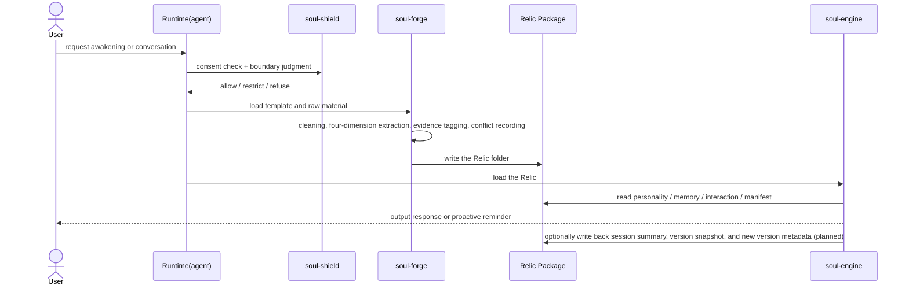

# Technical Architecture

The core of relic.skill is not a centralized service, but an architecture of "files as interfaces, directories as instances, Skills as runtime units." The minimal deployable object is not a database table, nor a cloud Agent — it's a Relic folder that any SKILL.md-compatible agent (Claude Code, Cursor, CodeBuddy, Kiro, …) can load directly. Three direct benefits: readable, auditable, portable. Memory isn't locked into a black-box platform, and users can manage their Relics the way they manage code.

## Design Goals

- **Local-first**: sensitive data stays in the user's own filesystem as much as possible.
- **Traceable evidence**: every persona conclusion points back to source material, or at least to an evidence level.
- **Subjects beyond humans**: humans, pets, relationships, teams, places, and moments all enter the same protocol.
- **Ethics first**: consent, boundaries, and identity labeling precede generation.
- **Continuously evolvable**: a Relic can be incrementally updated, re-fingerprinted, and version-diffed.
- **Host-friendly**: any agent that can read a Skill directory can run it.

## Architecture Diagram

```mermaid
flowchart TD
    A[Data sources<br/>chat logs / voice / photos / video / email / docs / live interview]
    B[Collection & parsing layer<br/>platform exports / manual organization / parsing scripts / format normalization]
    C[soul-shield<br/>consent check / identity labeling / soul fingerprint / ethics gate]
    D[soul-forge<br/>four-dimension extraction / evidence grading / conflict preservation / Relic packaging]
    E[Relic Package<br/>SKILL.md / personality.md / interaction.md / memory.md / manifest.json]
    F[soul-engine<br/>persona loading / memory retrieval / state machine / proactive behavior]
    G[Runtime adapter<br/>Claude Code / Kiro / CLI / future bots]
    H[User]
    I[Session logs & version snapshots (planned)]

    A --> B --> C --> D --> E --> F --> G --> H
    H --> G --> F
    F --> I
    I --> F
    E --> I
```

One important trade-off in this diagram: **relic.skill stabilizes the "representation layer" first, then deepens the "execution layer."** That is, the repo first fixes how a Relic is organized, the evidence rules, and the loading protocol — then lets specific runtimes interpret those files. This way, a Relic is not a private prompt of some model, but a reusable digital object.

## The Three Subsystems

### 1. soul-forge: the Soul Forge

`soul-forge` compresses raw material into a structured persona profile. It is not a simple summarizer, but a distillation system with rules. Four core responsibilities:

1. **Pick a template**: humans, pets, relationships, teams, places, moments — each has different observation priorities.
2. **Run four-dimension extraction**: cognition, expression, behavior, emotion — modeled separately.
3. **Tag evidence levels**: distinguish verbatim, artifact, and impression — avoid writing guesses as facts.
4. **Preserve contradictions**: conflicts are not smoothed away; they are kept with scene, time, and intensity.

What it outputs is not a one-line "this person is gentle," but a structure that can explain "why ta responds this way."

### 2. soul-engine: the Soul Engine

`soul-engine` brings an awakened Relic "alive" in conversation. It does not redefine the persona; it reads `SKILL.md`, `personality.md`, `interaction.md`, and `memory.md`, doing three things in the current context:

1. **Establish identity**: who ta is, the relationship with the user, what can and cannot be said.
2. **Retrieve memory**: pick the most relevant parts from long-term memory, event fragments, and the current session.
3. **Render expression**: generate responses per the subject's original tone, rhythm, boundaries, and interaction style.

The `soul-engine/` directory in this repo is still protocol-leaning, but the interface is already clear: any runtime that can read a Relic package and obey these rules is a legitimate engine implementation.

### 3. soul-shield: the Soul Shield

`soul-shield` is not an accessory — it is the master gate. It does three kinds of work:

1. **Consent control**: run the six-question consent first, then decide whether generation is allowed.
2. **Authenticity control**: verify whether content has been tampered with via the soul fingerprint.
3. **Ethics control**: refuse impersonation, misleading use, and high-risk scenarios.

In relic.skill, the shield is not "one safety note at the end" — it is a hard architectural dependency. Without it, a Relic slides from a memorial tool toward a risk tool.

## Data Flow

From the user's perspective, one complete data flow:



The truly stable boundary in this flow is the **Relic Package**. No matter what scripts parsed the data upstream, no matter what model runs it downstream, as long as the inputs and outputs honor this protocol layer, compatibility holds.

## The Relic File Format

A Relic is essentially a directory. Recommended structure:

```text
{slug}/
├── SKILL.md
├── personality.md
├── interaction.md
├── memory.md
├── manifest.json
├── evidence-map.md        # optional (planned): conclusion-to-evidence mapping
├── sources/               # optional: index of sanitized raw material
└── .versions/             # optional: version snapshots
```

### Core file notes

- **SKILL.md**: the entry file. Answers "who ta is, how ta is loaded, what the boundaries are."
- **personality.md**: the four-dimension persona profile, emphasizing stable patterns and conditional contradictions.
- **interaction.md**: interaction patterns across situations — comfort, small talk, conflict repair, holiday greetings.
- **memory.md**: high-recognizability memory fragments — both facts and relational anchors.
- **manifest.json**: version, sources, consent status, time range, fingerprint, and other metadata.

### manifest.json reference structure

```json
{
  "slug": "grandma-wangxiulan",
  "type": "human",
  "version": "1.0.0",
  "time_range": {
    "start": "2018-01-01",
    "end": "2025-03-01"
  },
  "sources": {
    "chat_messages": 1240,
    "voice_minutes": 38,
    "photos": 126
  },
  "consent": {
    "level": "A",
    "scope": "personal",
    "revocable": true
  },
  "evidence_profile": {
    "verbatim": 420,
    "artifact": 180,
    "impression": 63
  },
  "fingerprint": "relic:sha256:...",
  "disclaimer": "This is a Relic, not a real person."
}
```

This file matters, because it turns "feels like someone" into "an auditable digital object."

## The Memory System

README mentions a three-layer memory system. The clearest engineering split:

| Layer | Role | Primary Carrier | Update Frequency | Typical Content |
|---|---|---|---|---|
| Core Memory | stable identity anchors | `personality.md` + `manifest.json` | low | value ordering, tone, relational boundaries, taboo zones |
| Episodic Memory | retrievable long-term fragments | `memory.md` + `evidence-map.md` (planned) | medium | shared experiences, events, recurring details |
| Session Memory | temporary context of the current conversation | runtime cache / session logs (planned) | high | what was just discussed, the user's state today, current goals |

### Retrieval order

1. **Core memory first**: decides what can be said and how.
2. **Episodic memory next**: find the fragments most relevant to the current topic.
3. **Session memory last**: avoid answering off-topic; maintain continuity.

Benefits of this design:

- A single new conversation won't rewrite the root persona.
- Not all material is crammed into context, causing style drift.
- "Stable traits" and "temporary states" are explicitly separated.

## The Proactive Behavior System

A good Relic shouldn't just passively wait for knocks. It can speak up at the right moment — but only under conditions of **restraint, explainability, and switchability**. Recommended proactive chain:

```text
trigger → eligibility check → memory retrieval → tone rendering → output → cooldown record
```

### 1. Trigger layer

Common triggers:

- **Time**: festivals, birthdays, anniversaries, a fixed hour.
- **Relationship**: long stretches without contact, a shared-memory date arriving.
- **State**: the user is visibly tired, low, or anxious in the current session.
- **Context**: project wrap-up, graduation, moving, a pet's death anniversary.

### 2. Eligibility check

Not every trigger should become a message. The system must at least check:

- Whether the current moment is within allowed hours.
- Whether the proactive-disturbance frequency cap is exceeded.
- Whether the user has disabled proactive behavior.
- Whether the current situation would amplify dependence or a sense of misleading.

### 3. Memory retrieval and rendering

The trigger decides which class of fragments to retrieve, then output is generated per the tone templates in `interaction.md`. For example, a "grandma-type Relic" reminder should read like a light nag, not a task notification.

### 4. Cooldown and audit

Every proactive trigger should record: why it fired, which memory it used, when it last fired. This avoids "suddenly becoming annoying," and lets the user review it.

## Integration with Agents

relic.skill is naturally suited to Skill-type hosts — any agent that reads SKILL.md.

### agents-standard hosts (OpenClaw / CodeBuddy / WorkBuddy)

- Project install path: `.agents/skills/relic` (or project root)
- Global: `~/.agents/skills/relic`
- The host's read entry is the repo root's `SKILL.md`.

### Claude Code (if you use it)

- Project install path: `.claude/skills/relic`
- Global: `~/.claude/skills/relic`
- Common invocations: `/relic`, `/relic-forge`, `/relic-talk`, `/relic-shield`

### Kiro

- Recommended install path: `~/.kiro/skills/relic`
- Loading is similar to Claude Code; the entry is still `SKILL.md`; other files are read step by step via relative paths.

### What the adapter layer actually does

Whatever the host, the adapter layer essentially does four things:

1. Route user intent to the correct subsystem.
2. Load Relic files into the current context.
3. Write runtime-produced summaries or version snapshots back to the filesystem (planned).
4. Always declare clearly to the outside: "this is a Relic, not a real person."

## Current Form and Evolution Direction

This repo is currently more **docs-first**: it first fixes the philosophy, protocol, templates, boundaries, and directory structure. Its value is not "there's already a huge backend" — it's that **how a Relic should be described, verified, and loaded has already been made clear.**

Whether you later add Python parsing scripts, vector retrieval, voice synthesis, or expand into bot channels, none of it requires overturning this structure. Because the truly stable core is not a model version — it's the boundary of the Relic as a file object.

Simply put:

- `soul-forge` turns fragments into a silhouette;
- `soul-engine` makes the silhouette speak;
- `soul-shield` ensures it never crosses the line.

Together, they form a sustainable universal immortality engine.
